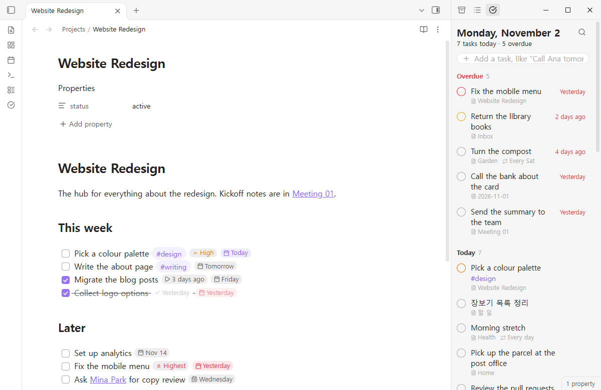
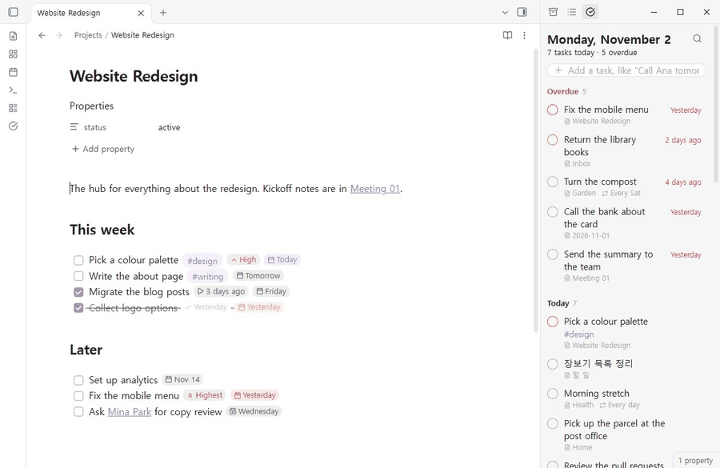

# Doable

**A calm agenda for the tasks already in your notes.**

Every `- [ ]` in your vault, sorted into what is late, what is today and what is coming. Add a task by writing it the way you would say it. Dates read as dates, not as `📅 2026-11-05`. And it writes the Tasks plugin format, so nothing in your vault has to change.





## Why

Tasks is the most used task plugin for a reason: your tasks stay plain Markdown, in the notes they belong to. But seeing today means writing a query, adding a date means remembering an emoji, and every line ends in a row of symbols. Doable keeps the format and changes the experience.

| With the Tasks format alone | With Doable |
|---|---|
| Write a query block to see today | Open the agenda: overdue, today, the next days, no date |
| Type `📅 2026-11-05` | Type "tomorrow", "fri", "nov 20", "in 3 days" |
| `📅 2026-11-05 🔁 every week ⏫` in the middle of your note | Small chips: "Thursday", "Every week", "High". Click one to change it |
| No undo when a task is ticked in a list | Every change shows Undo for a few seconds |

## The agenda

Open it from the ribbon or the command **Doable: Open**. It lives in the side panel.

- **Overdue, Today, the next 7 days one by one, Later, No date, Done today.** Empty days are skipped. Long sections show their first 40 tasks.
- **Tick the circle** to complete a task. The circle's colour is its priority.
- **Click the day** on the right to move it: today, tomorrow, this weekend, next week, a date from the month, or type one. The same panel sets the repeat.
- **Drag a task** onto a day heading to move it there, or onto **No date** to clear its date.
- **Right-click** for priority, cancel and open.
- **Keyboard:** arrow keys move, Space completes, Enter opens the note.
- **Filter** with the search icon: words, `#tags`, or a note's name.

## Add in plain words

The line at the top understands dates, repeats and priorities, and shows what it understood before you press Enter.

```
Call Ana tomorrow #home every week !high
→ - [ ] Call Ana #home ⏫ 🔁 every week 📅 2026-11-03
```

- **Days:** today, tomorrow, monday … sunday, next friday, next week, next month, this weekend, end of month, in 3 days, in 2 weeks, nov 20, 20 nov, 2026-11-20, by 11/20.
- **Repeats:** every day, every weekday, every week, every 2 weeks, every monday, every mon and thu, every month on the 1st, every year, daily, weekly, monthly, … when done.
- **Priority:** !highest, !high, !medium, !low, !lowest, or !1 to !5, or !! and !!!.
- **Korean and Chinese** too: 내일, 다음 주 수요일, 3일 후, 11월 5일, 매주 화요일, 매월 25일 · 明天, 下周三, 3天后, 12月1日, 每周五.

New tasks go to an inbox note (`Inbox.md`, created if missing) or to today's daily note, optionally under a heading. You choose in settings.

## Inside notes

- **Chips.** In Live Preview, a task's fields read as chips while you are not on that line. Put the cursor on the line and the plain text comes back. The file never changes until you edit it.
- **Click a chip** to change it: a date opens the picker, a priority steps to the next one.
- **Type `@`** on a task line for dates: `@fri`, `@tomorrow`, `@nov 20`. Anything that is not a date, like `@home`, is left alone.
- **Reading view** shows the same chips.
- Chips are never drawn inside code blocks or front matter.

## Your Tasks queries keep working

If the Tasks plugin is not enabled, Doable draws your existing ` ```tasks ` blocks, with the same rows as the agenda. ` ```doable ` blocks work whether Tasks is there or not.

The everyday part of the query language is supported:

```
not done
due before tomorrow
happens this week
scheduled 2026-11-01 2026-11-07
no due date
path includes Projects
tags include #work
description includes report
priority is above none
is recurring
group by filename
sort by due reverse
limit 20
```

`hide …`, `show …` and `short mode` are accepted and ignored. Anything else, such as boolean `AND`/`OR`, is listed under the results as not understood, instead of silently changing them.

## Same format, same results

Doable reads and writes exactly what the Tasks plugin does:

- Priorities 🔺 ⏫ 🔼 🔽 ⏬, dates 📅 ⏳ 🛫 ➕ ✅ ❌, repeats 🔁, 🏁 on completion, 🆔 and ⛔. Fields are read from the end of the line in any order and written back in Tasks' order.
- Completing a repeating task adds the next one above it (or below, if you prefer), with dates computed the way Tasks computes them, using the same rrule library: from the due date (or scheduled, or start), from the completion day for `when done`, with the 31st landing on the last day of shorter months.
- `🏁 delete` removes the finished task.
- On first run Doable takes your Tasks settings for the global filter, creation and completion dates, and where the next repeat goes.

You can run both plugins side by side. When Tasks is enabled, it keeps drawing ` ```tasks ` blocks and Reading view, and Doable stays out of its way.

## Safe edits

Every change finds its line again before writing: at the line it was read from if the text still matches, otherwise at the one place in the note with that exact text. If neither is certain, nothing is written and you are told why. When the note is open, the change goes through the editor, so unsaved typing is kept and the editor's own undo works too. Line endings are kept.

## What it is not

Doable is a list, not a project manager. There are no boards, Gantt charts, time tracking or calendar sync, on purpose.

## Settings

- Where new tasks go: an inbox note or today's daily note, and an optional heading.
- Only tasks with a tag (the Tasks global filter), and folders to ignore.
- Completion date, creation date, where the next repeat goes.
- Chips on or off, first day of the week, how many days are listed one by one.

## Install

Open **Settings → Community plugins → Browse**, search for **Doable**, install and enable it.

Works on desktop and mobile. The interface is in English, Korean and Simplified Chinese.

## Development

```bash
npm install
npm test
```

`npm test` runs the type check, build, unit tests and a bundle gate. `npm run demo-vault` builds a sample vault in `../데모_볼트` with tasks spread over projects, daily notes and an inbox, dated relative to today.

MIT licensed. Bundles [rrule](https://github.com/jkbrzt/rrule) (BSD-3-Clause); see THIRD-PARTY-NOTICES.md.
